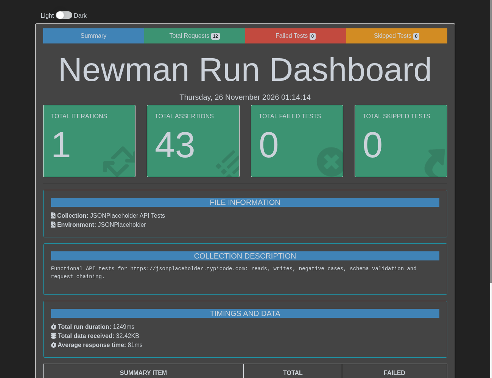

# JSONPlaceholder API Tests (Postman + Newman)

Automated REST API test suite for the public practice API [jsonplaceholder.typicode.com](https://jsonplaceholder.typicode.com). The tests live in a **Postman collection**, run from the command line with **Newman**, and execute automatically on every push through **GitHub Actions**.

<!-- After your first run, add a screenshot of reports/report.html to docs/report.png and uncomment the next line -->
<!--  -->

## What it covers

| Folder | Requests | What is verified |
|---|---|---|
| Posts - read | 4 | status codes, headers, array length, required fields, JSON schema, query filter, nested route |
| Posts - create, update, delete | 4 | POST (201), PUT, PATCH, DELETE, echoed data, assigned id |
| Negative tests | 2 | 404 for a missing post and an unknown resource |
| Chained flow | 2 | value from one response is saved and used by the next request |
| **Total** | **12 requests, 43 assertions** | every request also checks response time under 3 s |

## Tech stack

- Postman collection (v2.1) with JavaScript test scripts
- Newman CLI + htmlextra HTML reporter
- Node.js 18+
- GitHub Actions

## Project structure

```
.
├── collections/JSONPlaceholder_API_Tests.postman_collection.json
├── environments/jsonplaceholder.postman_environment.json   # baseUrl variable
├── package.json                                            # npm test runs Newman
└── .github/workflows/api-tests.yml                         # CI pipeline
```

## Run it

**Option A: command line (Newman)**

```bash
git clone https://github.com/Belaalos/jsonplaceholder-api-tests.git
cd jsonplaceholder-api-tests
npm install
npm test
```

The HTML report is saved to `reports/report.html`.

**Option B: Postman app**

1. Open Postman and click **Import**.
2. Import both files: the collection from `collections/` and the environment from `environments/`.
3. Select the **JSONPlaceholder** environment (top-right) and click **Run collection**.

## Continuous integration

Each push and pull request runs the collection on GitHub Actions. The HTML report is attached to the run (Actions tab > latest run > Artifacts).

## Notes

- JSONPlaceholder is a fake API: writes (POST, PUT, PATCH, DELETE) return realistic responses but do not change the stored data, so the tests are safe to repeat.
- The base URL is stored in an environment variable, so the same collection can be pointed at another environment by changing one value.

## Author

Belal Magdy | Software Testing & QA Automation | [LinkedIn](https://www.linkedin.com/in/belal-magdy-23sep2001)
